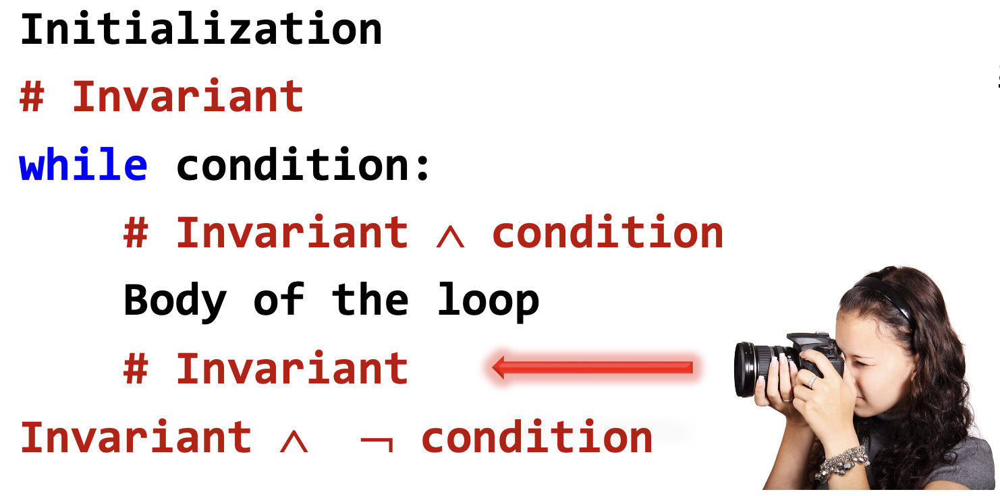
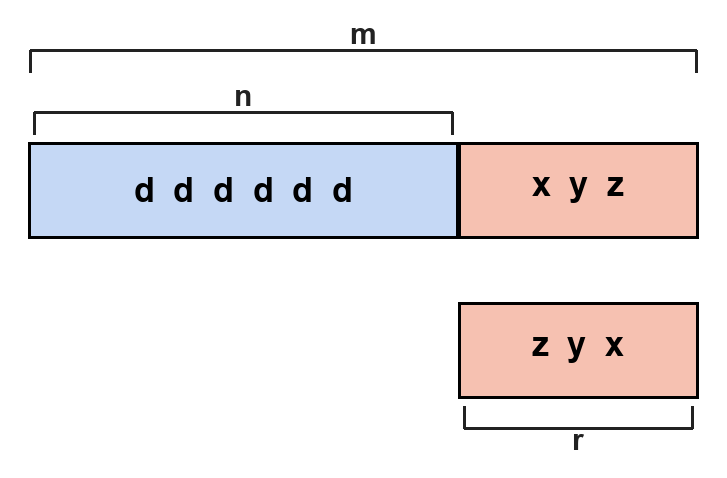
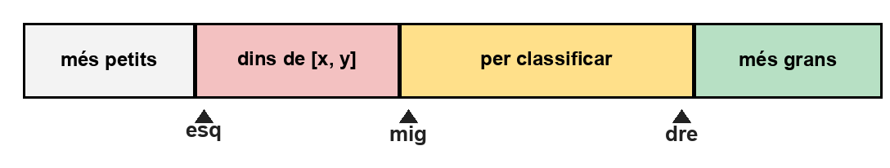

# Raonament amb invariants

Dissenyar un bucle vol dir decidir com s'inicialitzen les variables, quina condició el fa continuar, què fa el cos a cada volta i com es pot saber que acabarà. Un **invariant** és la propietat que lliga aquestes quatre decisions.

Aquesta lliçó presenta el raonament amb invariants, una manera sistemàtica de dissenyar bucles i de convèncer-se que fan el que han de fer. L'apliquem a tres exemples: el factorial, capgirar els dígits d'un nombre i classificar els elements d'una llista.

## Què és un invariant

Un invariant d'un bucle és una proposició sobre les variables del programa que es compleix:

- just abans de començar el bucle,
- al començament de cada iteració,
- al final de cada iteració.

Cada vegada que l'execució és a punt de comprovar la condició del `while`, l'invariant és cert. Dins del cos del bucle pot deixar de ser-ho un moment, però el cos del bucle l'ha de tornar a deixar establert abans de tornar a la condició.

L'invariant serveix per a quatre coses:

- diu com cal inicialitzar les variables abans del bucle,
- diu quina condició cal per arribar, en sortir, a la postcondició (allò que volem que sigui cert quan el bucle ha acabat),
- diu què ha de fer el cos del bucle,
- ajuda a detectar si el bucle acaba.

Triar-ne un de bo no sempre és fàcil, i és la part important del disseny. Convé raonar amb invariants en tots els bucles, ni que sigui de manera informal, i escriure'l explícitament quan el bucle no és trivial.

## Esquema general d'un bucle

El patró d'un bucle raonat amb un invariant és aquest:

```python
Inicialització()
# Invariant
while condició:
    # Invariant ∧ condició
    CosDelBucle()
    # Invariant
# Invariant ∧ ¬condició
```

(Recordeu que $P \land Q$ és la conjunció de $P$ i de $Q$, i $¬P$ és la negació de $P$.)

Hi ha quatre obligacions:

1. **Inicialització.** Les assignacions d'abans del bucle han de fer que l'invariant es compleixi.
2. **Cos.** Si a l'entrada del cos es compleixen l'invariant i la condició, al final del cos l'invariant ha de tornar a complir-se.
3. **Sortida.** L'invariant, juntament amb el fet que la condició ja no es compleix, ha d'implicar la postcondició. Això és el que fixa la condició del `while`.
4. **Terminació.** Cal una quantitat entera que decreixi a cada iteració i que no pugui decréixer per sempre. Llavors el bucle acaba.

Una manera pràctica de trobar l'invariant és aturar mentalment el programa al final del cos, mirar les variables i descriure què és veritat del seu contingut. Si aquesta descripció es manté a cada volta, és l'invariant.



Fixeu-vos que l'invariant descriu una _propietat estàtica i atemporal_ del bucle: l'invariant captura la relació entre les variables en un instant donat (en tres punts determinats). Un error freqüent és confondre l'invariant amb alguna _propietat dinàmica o temporal_ del bucle. En un invariant consideracions del tipus _abans_, _després_, _fins que_, _mentre_, _valor anterior_,... són errònies. Penseu en l'invariant com a un fotograma, no la pel·licúla resultant de passar els fotogramas successius més o menys ràpid.

## El factorial

Donat un enter $n \ge 0$, volem calcular $n!$. El factorial es defineix així:

$$
n! = 1 \cdot 2 \cdot 3 \cdot \ldots \cdot n,
$$

Recordeu que $0! = 1$ per la definició.

Volem omplir les quatre obligacions de l'esquema general. Comencem per l'esquema:

```python
...
# Invariant
while condició:
    # Invariant ∧ condició
    ...
    # Invariant
# Invariant ∧ ¬condició
```

Triem aquest invariant: a cada iteració mantindrem

$$
f = i! \quad\text{i}\quad i \le n.
$$

La inicialització en surt de seguida: Volem $f = i!$ amb $i \le n$, i sabem que $0! = 1$. La precondició (allò que podem suposar de l'entrada) diu que $n \ge 0$, així que podem posar `i = 0` i `f = 1`. Per tant, ara tenim aquest fragment:

```python
i = 0
f = 1
# f = i! ∧ i ≤ n
while condició:
    # f = i! ∧ i ≤ n ∧ condició
    ...
    # f = i! ∧ i ≤ n
# f = i! ∧ i ≤ n ∧ ¬condició
```

La condició del bucle surt de la postcondició: En acabar volem $f = n!$. Si l'invariant ens dóna $f = i!$ i $i \le n$, n'hi ha prou que en sortir es compleixi $i = n$. Per tant la condició del `while` és `i != n`: mentre sigui certa encara no hem acabat, i quan deixa de ser-ho l'invariant obliga $i = n$ i, amb ell, $f = n!$. Per tant, ara tenim aquest fragment:

```python
i = 0
f = 1
# f = i! ∧ i ≤ n
while i != n:
    # f = i! ∧ i ≤ n ∧ i != n   ⟺    f = i! ∧ i < n
    ...
    # f = i! ∧ i ≤ n
# f = i! ∧ i ≤ n ∧ i = n   ⟺    f = n!
```

Com que al final del programa tenim $f = n!$, és clar que cal retornar $f$. Per tant, ara tenim aquest fragment:

```python
i = 0
f = 1
# f = i! ∧ i ≤ n
while i != n:
    # f = i! ∧ i ≤ n ∧ i != n   ⟺    f = i! ∧ i < n
    ...
    # f = i! ∧ i ≤ n
# f = i! ∧ i ≤ n ∧ i = n   ⟺    f = n!
return f
```

El cos ha de restaurar l'invariant. Si fem `i = i + 1`, el nou valor d'`i` és una unitat més gran i el factorial que li correspon és l'antic multiplicat per aquest `i` nou. Cal, doncs, incrementar primer i multiplicar després. Per tant, ara tenim aquest fragment:

```python
i = 0
f = 1
# f = i! ∧ i ≤ n
while i != n:
    # f = i! ∧ i ≤ n ∧ i != n   ⟺    f = i! ∧ i < n
    i = i + 1
    f = f * i
    # f = i! ∧ i ≤ n
# f = i! ∧ i ≤ n ∧ i = n   ⟺    f = n!
return f
```

El bucle acaba perquè `i` comença a 0, creix d'un en un i la precondició assegura $n \ge 0$: `i` no pot avançar per sempre sense arribar a `n`.

Tot plegat:

```python
def factorial(n: int) -> int:
    """Retorna n!. Precondició: n ≥ 0."""

    i = 0
    f = 1
    # f = i! ∧ i ≤ n
    while i != n:
        # f = i! ∧ i ≤ n ∧ i != n   ⟺    f = i! ∧ i < n
        i = i + 1
        f = f * i
        # f = i! ∧ i ≤ n
    # f = i! ∧ i ≤ n ∧ i = n   ⟺    f = n!
    return f
```

Com heu vist, hem utilitzant l'invariant per guiar tota l'escriptura de la funció. Evidentment, trobar un invariant bo no és fàcil i requereix ingeni i molta pràctica, però igualement també calia ingeni i molta pràctica per escriure programes correctes! A més, l'invariant proporciona una documentació implícita que explica la raó del funcionament del programa: el que fa el bucle és mantenir l'invariant. L'invariant elimina el component intuitiu del disseny o l'anàlisi de programes iteratius.

## Capgirar els dígits

Volem una funció que, donat un enter $m \ge 0$, en retorni un altre $r$ amb els mateixos dígits en base 10 escrits del revés. Aquests són alguns exemples:

|   `m` |   `r` |
| ----: | ----: |
| 35276 | 67253 |
|    19 |    91 |
|     3 |     3 |
|     0 |     0 |
|   100 |     1 |

L'invariant el representa gràficament com a segueix:



Els dígits de `m` són alguns dels dígits en blau a la part esquerra de la figura seguits dels dígits en vermell a la part dreta. Aquests dígits extrets es dibuixen en vermell en l'ordre original, `xyz`, just darrere de `n`, de manera que els dos trossos de dalt reconstrueixen `m`. La variable `r` no els guarda en aquest ordre: en guarda el revés, `zyx`. El tros vermell de dalt no és una variable; només fa visible la relació entre `m`, `n` i `r`.

Quan `n` val 0 ja no queda cap dígit per extreure, així que `r` és `m` escrit del revés. La condició del bucle és, per tant, `n != 0`.

Al començament no hem extret res: `n` és tot `m` i `r` és 0, que aquí vol dir «cap dígit», no pas el dígit 0. El cos treu l'últim dígit de `n` i l'afegeix al final de `r`:

```python
r = 10 * r + n % 10
n = n // 10
```

`n` és un enter no negatiu i a cada volta es divideix per 10, de manera que arriba a 0 i el bucle acaba.

```python
def capgira_digits(m: int) -> int:
    """Retorna l'enter obtingut escrivint els dígits de m del revés.
    Precondició: m ≥ 0.
    """

    n, r = m, 0
    # Invariant: els dígits de m són els de n seguits del revés dels de r
    while n != 0:
        r = 10 * r + n % 10
        n = n // 10
    return r
```

Com veieu, un invariant gràfic com el donar ajuda a dissenyar i comprendre el bucle.

## Classificar els elements d'una llista

Tenim una llista `L` i un interval `[x, y]`, amb `x <= y`. Volem reordenar `L` de manera que els elements menors que `x` quedin a la part esquerra, els majors que `y` a la part dreta, i els de l'interval al mig. Dins de cada part, l'ordre no importa.

Per a l'interval `[6, 9]` i la llista `[15, 7, 3, 0, 10, 6, 11, 9, 1, 13]`, un resultat possible és `[1, 3, 0; 7, 9, 6; 11, 10, 13, 15]`: els tres primers són menors que 6, els tres següents cauen dins de `[6, 9]` i els quatre últims són majors que 9. Evidentment, hi ha altres resultats correctes possibles.

Resoldre aquest problema amb una llista auxiliar és fàcil (penseu com fer-ho). Però ara ho farem sense per no haver de mantenir una còpia de tots els elements de la llista i, per tant, estalviar memòria.

Per anar classificant sense fer servir una llista auxiliar, mantindrem quatre zones:



Els índexs `esq`, `mig` i `dre` marquen els límits de les zones:

- `L[0:esq]` conté elements estrictament menors que `x`,
- `L[esq:mig]` conté elements de l'interval `[x, y]`,
- `L[dre + 1:]` conté elements estrictament majors que `y`,
- `L[mig:dre + 1]` conté elements dels quals no s'afirma res.

Això és l'invariant. La fletxa `dre` és al límit dret de la zona pendent: `dre` és l'índex de l'últim element per classificar, i tot el que queda a la seva dreta ja és més gran que `y`.

Al començament tota la llista està per classificar, així que `esq = mig = 0` i `dre = len(L) - 1`. Acabem quan la zona pendent és buida, és a dir, quan `mig > dre`. La condició del bucle és, doncs, `mig <= dre`.

A cada volta mirem l'element `L[mig]`, el primer dels pendents:

- Si és menor que `x`, l'intercanviem amb `L[esq]` i avancem `esq` i `mig`. L'element petit queda a la zona de l'esquerra. Si la zona del mig no era buida, l'element que hi havia a `esq` ja era de l'interval i, en avançar `mig`, continua dins d'aquesta zona. Si era buida, `esq` i `mig` coincideixen i l'intercanvi no mou res.

- Si és major que `y`, l'intercanviem amb `L[dre]` i reculem `dre`. L'element gran passa a la zona de la dreta. L'element que arriba a la posició `mig` encara no l'hem mirat, i per això `mig` no avança.

- Si cau dins de `[x, y]`, no es mou. Només avancem `mig`, i la zona del mig el va absorbint.

Cada volta fa créixer `mig` o fa decréixer `dre`, de manera que la distància `dre - mig` baixa. El bucle acaba.

El resultat és aquesta acció:

```python
def classifica(L: list[int], x: int, y: int) -> None:
    """Reordena L: a l'esquerra els elements menors que x,
    a la dreta els majors que y, i al mig la resta.
    Precondició: x ≤ y.
    """

    esq, mig, dre = 0, 0, len(L) - 1
    # Invariant: vegeu les quatre zones de la figura
    while mig <= dre:
        if L[mig] < x:
            L[mig], L[esq] = L[esq], L[mig]
            esq, mig = esq + 1, mig + 1
        elif L[mig] > y:
            L[mig], L[dre] = L[dre], L[mig]
            dre = dre - 1
        else:
            mig = mig + 1
```

Sobre l'exemple anterior, aquesta funció deixa exactament `[1, 3, 0; 7, 9, 6; 11, 10, 13, 15]`.

Fixeu-vos que, per a tenir èxit, el nostre invariant ha hagut d'acomodar en certa manera una part desconeguda dels elements: la llista queda partida en quatre zones, no tres com el resultat exigeix.

## Com trobar un bon invariant

Els invariants són una manera efectiva d'obtenir algorismes iteratius correctes. Per trobar-ne un de bo en un bucle nou, aquest ordre funciona bé:

1. Penseu com avança l'algorisme, volta a volta.
2. Descriviu l'estat del programa al començament d'una iteració qualsevol. Aquesta descripció és l'invariant.
3. Declareu les variables que fan falta per escriure'l.
4. Deduïu-ne la inicialització, la condició i el cos. L'ordre en què ho feu no és important: cadascun ha de complir l'obligació que li toca a l'esquema general, i cal comprovar que el bucle acaba.

## Errors freqüents

- No considerar l'invariant com a una propietat estàtica i atemporal del bucle, sinó com a una propietat dinàmica o temporal.
- Treballar amb un invariant massa fort, cal afeblir el resultat desitjat per poder-hi anar convergint incrementalment a casa pas del bucle.
- Treballar amb un invariant massa fluix, que no estableixi totes les relacions necessàries entre totes les variables del bucle.

<Autors autors="jordic jpetit"/>
